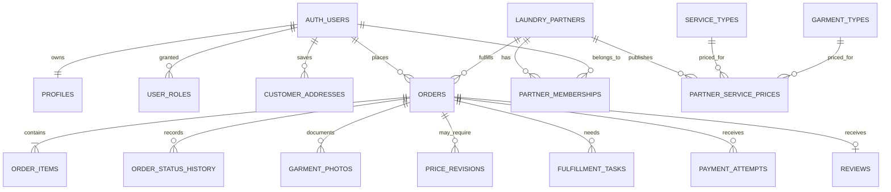

# Laundry Marketplace: Database Architecture (Design Draft)

**Status:** Review draft. No migration has been applied to Supabase.  
**Target:** Supabase PostgreSQL 17, project `laundry-marketplace-india` (Mumbai, `ap-south-1`).  
**Product:** Multi-partner hyperlocal services marketplace, not a single laundry storefront.

## 1. Scope and engineering principles

This document defines a target data model for the full marketplace and a **small first implementation slice**. The Expo app currently reaches Supabase Auth, but user registration, database access, ordering, and payments are not yet implemented.

- Supabase Auth owns credentials and sessions in `auth.users`; app-specific user data stays in `public` with strict Row Level Security (RLS).
- All money is stored as **integer paise**, with an explicit `currency = 'INR'`. No floating-point money calculations.
- Customer-provided totals, prices, shop verification statuses, partner roles, payment confirmations and order status updates are untrusted. Server-side operations determine these.
- Partners must be **verified** before appearing in customer searches or accepting real orders.
- Serviceability uses **PostGIS** geography and partner coverage policy. Straight-line distance is not represented as road distance or delivery ETA.
- Order items preserve historical unit price and service snapshots. Later edits to the live price catalog must not mutate existing invoices.
- Every important operational transition is audited. Images are stored in **private buckets** with database metadata, access policies and retention rules.
- No production customer data, paid integrations or payment collection until privacy and security tests pass.

## 2. Roles and ownership

Roles: `customer`, `laundry_partner`, `delivery_partner`, `admin`. A person may have more than one role. A laundry partner is a **business**, not merely a role assigned to one login.

| Entity | Owner / access model |
| --- | --- |
| `profiles` | User's own private profile; admins only through privileged server paths |
| `user_roles` | Roles granted through trusted backend workflows, never from client-editable profile fields |
| `customer_addresses` | Address owner; accepted partner / assigned courier gets only the minimum address information needed for their active task |
| `laundry_partners` | Approved partner public business details; draft/verification and internal records restricted |
| `partner_memberships` | Owner/staff membership verified server-side |
| `orders` and `order_items` | Customer and designated partner staff, subject to state-based restrictions |
| `payments`, `refunds`, `settlements` | Customer's own payment summaries, partner's own statement; writes restricted to verified backend operations |

**Authorization warning:** `auth.users.raw_user_meta_data` is user-editable. It must **never** decide admin access, partner approval or business ownership. Use trusted database-controlled memberships or app metadata with server-authoritative assignment.

## 3. Proposed tables

### A. Accounts and businesses

| Table | Key columns and constraints |
| --- | --- |
| `profiles` | `id uuid PK -> auth.users.id`, `display_name`, `phone`, `created_at`, `updated_at` |
| `user_roles` | `user_id FK`, `role`, unique (`user_id`, `role`) |
| `customer_addresses` | `id uuid PK`, `user_id FK`, label, address lines, locality, city, pincode, `coordinates geography(Point,4326)`, `created_at` |
| `laundry_partners` | `id uuid PK`, `owner_user_id FK`, business name, slug, business location geography, public locality, `verification_status` (`draft/pending/approved/rejected/suspended`), `is_accepting_orders`, timestamps |
| `partner_memberships` | `partner_id FK`, `user_id FK`, `member_role` (`owner/manager/staff`), unique (`partner_id`, `user_id`) |
| `partner_opening_hours` | `partner_id FK`, weekday, opening/closing local time, unique partner/day/interval; use partner time zone |
| `partner_closures` | `partner_id FK`, start/end timestamptz, reason |
| `partner_service_areas` | `id uuid PK`, `partner_id FK`, service radius or approved `geometry(MultiPolygon,4326)` coverage, pickup capability |
| `partner_capacity` | `partner_id FK`, date, max garment units/orders, reserved capacity and closure flags, unique partner/date |

### B. Catalog and pricing

| Table | Key columns and constraints |
| --- | --- |
| `service_types` | `id PK`, code unique (`iron`, `wash_fold`, `wash_iron`, `dry_clean`), display label, active flag |
| `garment_types` | `id PK`, code unique, display label, category and active flag |
| `partner_service_prices` | `id PK`, `partner_id FK`, `service_type_id FK`, `garment_type_id FK`, `unit_price_paise >= 0`, `currency='INR'`, `turnaround_minutes > 0`, express eligible, active flag, unique partner/service/garment |
| `partner_delivery_terms` | `partner_id FK`, minimum order paise, pickup/drop modes, service fees, express policy, time-slot rules; define effective dates when pricing becomes more complex |

**Pricing policy:** Display a quote, then recalculate on the backend from catalog records and delivery terms. Inspection changes require an explicit proposed revision and customer acceptance. Discounts, taxes and final totals need auditable components.

### C. Booking, garment evidence and fulfillment

| Table | Key columns and constraints |
| --- | --- |
| `orders` | `id uuid PK`, human-readable reference unique, `customer_id FK`, `partner_id FK`, status, priority, fulfillment method, timestamps, price and fee snapshots in paise, `currency='INR'`, `version` for concurrency |
| `order_items` | `id uuid PK`, `order_id FK`, service type, garment type, quantity > 0, unit price snapshot paise, line total paise, instructions |
| `order_fulfillment_addresses` | `order_id PK/FK`, immutable pickup/drop address snapshot and contact data; **not available in initial partner browsing** |
| `garment_photos` | `id uuid PK`, `order_id FK`, optional `order_item_id FK`, `uploaded_by FK`, private storage path, photo purpose, MIME type, size, created_at |
| `order_status_history` | `id PK`, order FK, from/to states, actor ID, reason, created_at; append-only |
| `price_revisions` | `id PK`, order FK, proposed breakdown, reason, proposer, `pending/accepted/rejected/expired`, customer decision timestamp |
| `fulfillment_tasks` | `id PK`, `order_id FK`, task kind (`pickup/dropoff`), assigned courier/staff, status, scheduled window, handoff timestamps, exception notes |
| `handoff_proofs` | `id PK`, `fulfillment_task_id FK`, proof method, private evidence path, verified timestamp, actor; do not store plaintext OTPs |
| `order_issues` | `id PK`, order FK, type (`missing/damaged/delay/dispute/other`), description, state and resolution |

### D. Payments, reviews and administration

| Table | Key columns and constraints |
| --- | --- |
| `payment_attempts` | `id PK`, order FK, payment provider IDs unique where present, amount paise, verified state; server writes only |
| `payment_webhook_events` | `provider_event_id unique`, received/processed timestamps, handling status; idempotency |
| `invoices` and `invoice_lines` | Invoice number unique, order FK, itemized tax/fees/discounts and immutable totals |
| `refunds` | `id PK`, payment attempt FK, amount paise, provider reference, reason, verified status |
| `settlement_entries` | Partner FK, order/payment reference, gross, platform fee, adjustments, net in paise, payout status, timestamp |
| `reviews` | `id PK`, completed order FK unique, reviewer/customer FK, partner FK, rating 1–5, optional text, moderation state |
| `support_tickets` | `id PK`, creator FK, optional order FK, issue type, status, assignment and audit metadata |
| `notifications` | `id PK`, user FK, order FK nullable, event type, delivery status, created_at |

**Scope control:** Only implement the tables needed for each finished vertical slice. These are target entities, not instructions to create 30 empty tables at once.

## 4. Relationship overview

## 5. Order state machine

Proposed standard pickup-and-delivery flow:

`requested -> accepted -> pickup_scheduled -> picked_up -> inspection -> processing -> ready -> out_for_delivery -> completed`

- `requested`: customer has created a server-priced order. No partner claim of acceptance yet.
- `accepted`: designated partner accepts and capacity is reserved.
- `pickup_scheduled`: pickup window assigned.
- `picked_up`: verifiable chain of custody recorded.
- `inspection`: physical count and garment condition confirmed. Any price revision requires customer approval before charge/further processing.
- `processing`: laundry work in progress.
- `ready`: collection/delivery ready.
- `out_for_delivery`: rider/staff handoff confirmed.
- `completed`: confirmed delivery or self-collection handoff.

Alternative flows: self-drop skips pickup stages; partner rejection or acceptance timeout leads to `declined`/rebooking; customer cancellation allowed only under configured policy; exceptions such as `on_hold`, damaged garments or failed delivery have dedicated controlled transitions.

**Never** let a client update an arbitrary status. Use a server-side transition service/transaction that checks authenticated actor, role, current state, permitted transition, stale version, and records history atomically.

## 6. RLS and least-privilege access

1. RLS enabled on **every** `public` table immediately when created.
2. `anon`: may read only approved **public partner listing**, active catalog and intentionally public service information. No customer identity/address/order/media/payment access.
3. `authenticated` customers: own profile/addresses, own orders and permitted photos; can request an order through validated backend function. Cannot self-award roles or modify payment totals.
4. `authenticated` verified partner members: read only their own business's operational data and assigned order details. Protect customer full pickup address until order acceptance/assigned pickup need.
5. Delivery staff: read only assigned active tasks and minimal contact/location for fulfillment, not unrelated order financials.
6. Admin workflows run only behind server-verified authorization. Admin status cannot be granted through user-editable metadata, unaudited client update, or a permissive RLS policy.
7. Explicit grants to `anon`/`authenticated` only for necessary Data API tables and operations. Grants and RLS are **both** necessary.
8. Any elevated function uses a restricted schema, explicit EXECUTE grants, validated actor checks, bounded inputs and fixed search path. Prefer normal invoker functions when possible.
9. No public storage buckets for customer garment photos, inspection evidence, addresses, or invoices.

## 7. First three vertical slices

### Slice 1: Authentication and personal profile

Schema: `profiles`, `user_roles` (minimum trusted role assignment).  
App: email/password register, sign-in, sign-out, session restore, profile edit.  
Tests: unauthenticated reads denied; user A cannot read/update user B; client cannot grant itself admin or partner; failures do not leak account details.

### Slice 2: Verified partner discovery

Schema: laundry partners, membership, service types, garment types, partner prices, service areas.  
App: browse only approved, active, serviceable partners with actual offerings; accurate “not available” states.  
Tests: draft/suspended partners invisible, another partner cannot edit prices, geospatial filters work, no fake real-time ETA or fabricated ratings.

### Slice 3: Booking and partner acceptance

Schema: orders, order items, minimal address snapshot, status history.  
App: customer creates a server-priced order; partner accepts; customer sees persisted state.  
Tests: cross-user isolation, changed client totals rejected, stale state conflicts, invalid transitions denied, concurrent duplicate requests idempotent.

Photo proof, delivery network, payment and payout integration are **later slices** with their own security and integration tests.

## 8. Migration and verification protocol

- Keep schema migrations under `supabase/migrations/` with generated CLI migration names; each meaningful migration is reviewed in Git.
- Draft SQL and tests against a local/disposable development environment first. Avoid destructive changes to shared data.
- For every table, define RLS, minimal API grants, constraints, indexes and explicit test cases in the same slice.
- Check Supabase security/performance advisors, TypeScript type generation and test output after schema changes.
- Use an unprivileged test user to verify positive and negative permissions, not only a service-role key (which bypasses RLS).
- Keep documentation truthful: Auth HTTP 200 is only connectivity and does not prove application database access.

## 9. Decisions to validate before booking implementation

1. Does each order belong to exactly **one partner**, or can one checkout split across partners? **Default proposed:** one partner per order.
2. Can customers choose individual services per garment in one order? **Default proposed:** yes.
3. Are pickup and return handled by each laundry initially? **Default proposed:** yes, with optional platform riders later.
4. Is inspection price adjustment allowed? **Default proposed:** only after customer explicitly approves a revised quote.
5. What cancellation, lost/damaged clothing, and refund policies apply? Must be defined before collecting real money.
6. What partner identity/business verification is needed under local law? Confirm before public onboarding.
7. How long are customer/garment photos, order history, evidence and location data retained? Define retention/deletion policy.

**Review gate:** Do not run SQL or deploy these tables until the architecture and initial slice are reviewed.
